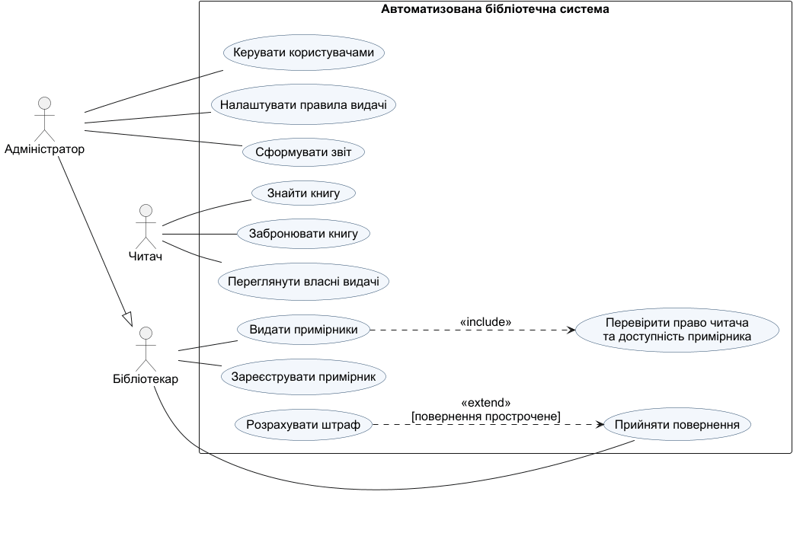
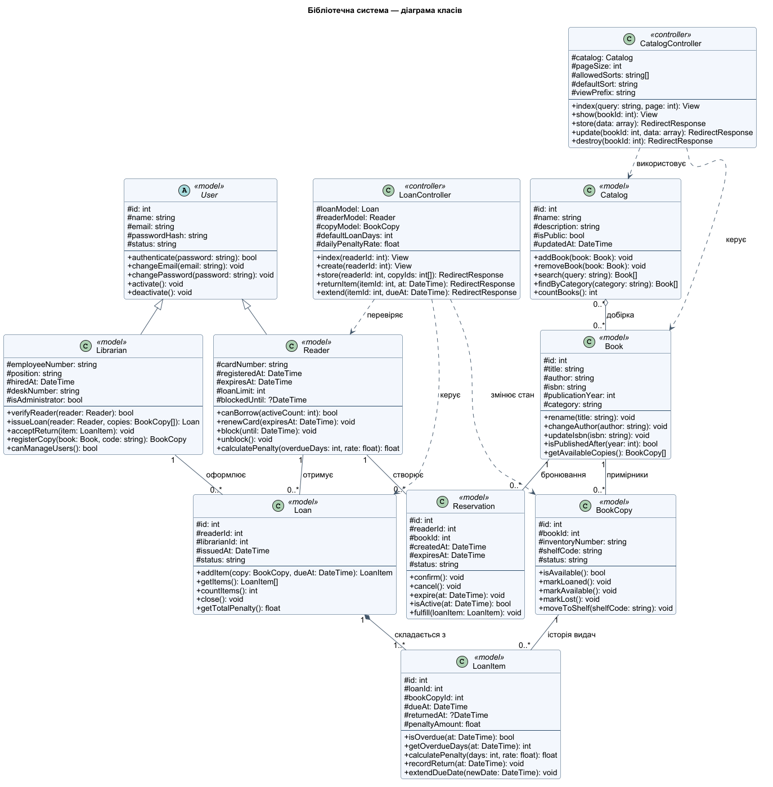
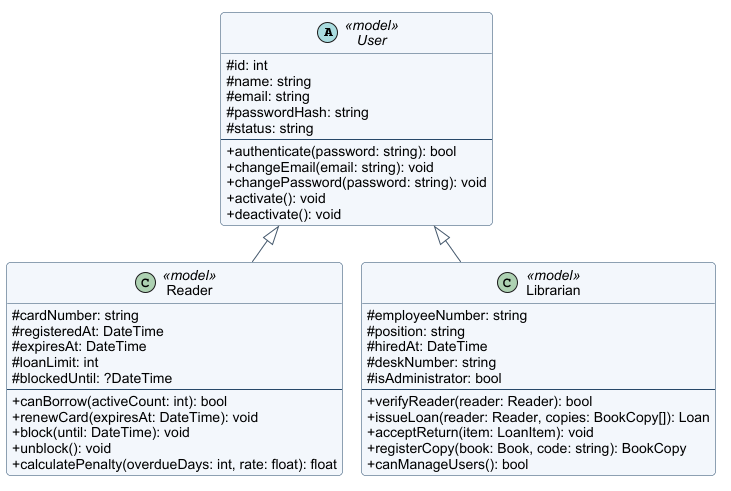
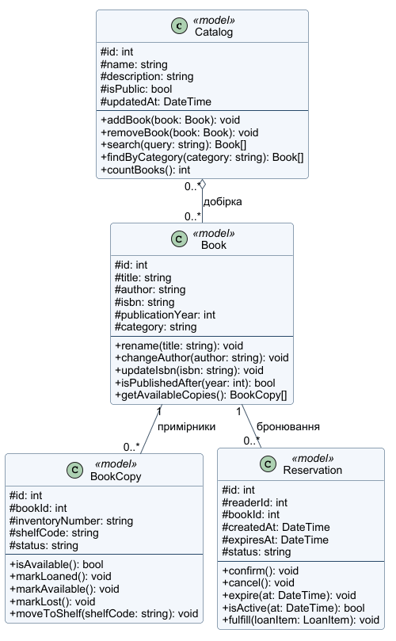
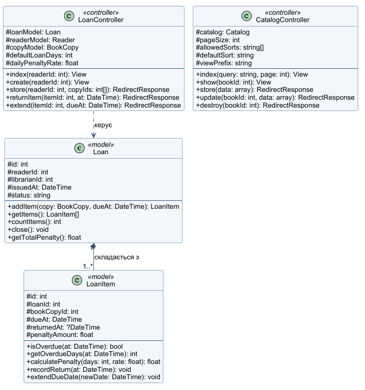

# Автоматизована бібліотечна система

## Мета та межі проєкту

Лабораторна робота №2 присвячена аналізу предметної галузі та проєктуванню вебсистеми бібліотеки. Результат роботи — функціональні вимоги, три описи Use Cases і UML-діаграми, які визначають основу майбутнього PHP/Laravel-додатку.

Система автоматизує пошук книг, облік фізичних примірників, бронювання, видачу та повернення літератури. Основна відмінність сутностей: Book описує видання, а BookCopy — конкретний фізичний примірник з унікальним інвентарним номером. Платіжний шлюз, міжбібліотечний обмін і цифрове читання не входять у межі цієї версії.

## Характеристики системи

### Основні функції

1. Пошук видань за назвою, автором, ISBN та категорією.
2. Перегляд доступності фізичних примірників і місця їх зберігання.
3. Бронювання видань, перегляд і скасування власних бронювань.
4. Реєстрація читачів та перевірка чинності читацького квитка.
5. Оформлення видачі одного або кількох примірників читачеві.
6. Реєстрація повернення, визначення прострочення та розрахунок штрафу.
7. Додавання видань і примірників, зміна їхнього стану та розміщення.
8. Керування користувачами та параметрами видачі адміністратором.
9. Формування звітів про прострочення, популярні книги та стан фонду.

### Користувачі

| Роль | Повноваження |
| --- | --- |
| Читач | Шукає книги, бронює видання, переглядає власні видачі. |
| Бібліотекар | Видає примірники, приймає повернення, реєструє примірники. |
| Адміністратор | Керує користувачами, правилами видачі та звітністю; успадковує можливості бібліотекаря. |

В обраній моделі адміністратор є бібліотекарем із правом isAdministrator. Окремої моделі Administrator немає. Доступ перевіряється Laravel Policies; приховування кнопок у Views не замінює серверної авторизації.

### Архітектура MVC

Model: User, Reader, Librarian, Catalog, Book, BookCopy, Loan, LoanItem і Reservation зберігають стан та інваріанти предметної галузі. User є абстрактним типом, а Reader і Librarian описують спеціалізовані профілі.

Controller: CatalogController обробляє запити каталогу, LoanController — видачу, повернення та продовження. Контролери перевіряють права доступу й вхідні дані, викликають моделі та повертають View або RedirectResponse.

View: Blade-шаблони каталогу, особистого кабінету та робочого місця бібліотекаря відображають дані. Це шаблони, а не додаткові класи на діаграмі. Модель є проєктною: перелік контролерів показує ключові потоки, а не повну реалізацію всіх маршрутів.

### Логічні сутності та таблиці

| Сутність | Таблиця | Основні дані та зв'язки |
| --- | --- | --- |
| User | users | id, name, email, password_hash, status; email унікальний. |
| Reader | reader_profiles | user_id, card_number, registered_at, expires_at, loan_limit, blocked_until; user_id — унікальний зовнішній ключ users. |
| Librarian | librarian_profiles | user_id, employee_number, position, hired_at, desk_number, is_administrator; профіль працівника. |
| Catalog | catalogs | id, name, description, is_public, updated_at; тематична добірка. |
| Book | books | id, title, author, isbn, publication_year, category; опис видання. |
| Належність до каталогу | book_catalog | catalog_id, book_id; унікальна пара зовнішніх ключів. |
| BookCopy | book_copies | id, book_id, inventory_number, shelf_code, status; inventory_number унікальний. |
| Loan | loans | id, reader_id, librarian_id, issued_at, status; заголовок видачі. |
| LoanItem | loan_items | id, loan_id, book_copy_id, due_at, returned_at, penalty_amount; позиція видачі. |
| Reservation | reservations | id, reader_id, book_id, created_at, expires_at, status; бронювання видання. |

Reader і Librarian у UML успадковують User. У реляційній реалізації застосовується таблиця users і пов'язані профілі, а не автоматичне успадкування таблиць Eloquent. camelCase у моделі відповідає snake_case у БД. Значення penalty_amount зберігається як DECIMAL(10,2); float використовується лише у навчальних сигнатурах розрахунку.

### Бізнес-правила

- Видача дозволена лише активному читачеві з чинним квитком, без блокування та з невичерпаним лімітом.
- Один примірник може мати не більше однієї неповерненої позиції видачі. Перевірка й зміна стану виконуються в одній транзакції з блокуванням відповідного запису.
- Збережена видача містить щонайменше одну позицію; проміжній побудові об'єкта до збереження це правило не заважає.
- Історія видач зберігається. Видання, примірники та користувачі з історією не видаляються каскадно; застосовуються архівування або обмеження видалення.
- Для демонстрації прийнято строк видачі 14 днів, ліміт 5 активних примірників і ставку штрафу 2 грн за день. Це проєктні налаштування, а не встановлені правила реальної бібліотеки.
- Штраф дорівнює кількості днів прострочення, помноженій на денну ставку. Від'ємні аргументи заборонені.
- Бронювання має стани pending, confirmed, fulfilled, cancelled, expired; підтверджене бронювання іншого читача враховується під час видачі.

### Сценарії та вихідні дані

Три основні сценарії: знайти книгу, забронювати книгу, оформити видачу. Їх деталізовано нижче. Додатковий сценарій — повернення із розрахунком штрафу за потреби.

| Вихідні дані | Вміст | Одержувач |
| --- | --- | --- |
| Каталог результатів пошуку | Назва, автор, рік, ISBN, кількість доступних примірників | Читач |
| Підтвердження видачі | Номер видачі, читач, примірники, дата видачі та строки повернення | Читач і бібліотекар |
| Звіт про прострочення | Читач, примірник, кількість днів і розрахована сума | Бібліотекар та адміністратор |
| Звіт про фонд і популярність | Кількість примірників за станами та кількість видач за виданнями | Адміністратор |

## UC1 Знайти книгу

Форма: коротка. Головний актор: читач.

Читач відкриває каталог, вводить назву, автора або ISBN і, за потреби, обирає категорію. Система перевіряє запит та показує відповідні видання з кількістю доступних примірників. Читач відкриває картку потрібної книги та переглядає її опис і доступність.

## UC2 Забронювати книгу

Форма: поверхнева. Головний актор: читач.

Головний успішний сценарій: авторизований читач відкриває картку книги й обирає бронювання. Система перевіряє активність читацького профілю та відсутність дубльованого активного бронювання, створює заявку з терміном дії й показує її номер і статус в особистому кабінеті. Коли примірник доступний для цього читача, бібліотекар підтверджує бронювання.

Альтернативи: неавторизованому користувачеві пропонується увійти; заблокованому читачеві пояснюється причина відмови; за наявності активного бронювання відкривається існуюча заявка; за відсутності доступного примірника заявка залишається pending; у разі помилки збереження заявка не створюється, повторна спроба не повинна породжувати дубль.

## UC3 Видати примірники читачеві

Форма: повна. Це ключовий варіант використання, оскільки він змінює облік фонду та відповідальність читача за отримані примірники.

### Назва область і рівень

Use Case Name: Видати примірники читачеві. Scope: автоматизована бібліотечна система, System. Level: User-goal. Primary Actor: бібліотекар.

### Зацікавлені сторони

Читач зацікавлений у швидкому отриманні потрібних книг і зрозумілих строках повернення. Бібліотекар потребує точного обліку та пояснення причин відмови. Адміністратор і бібліотека зацікавлені у збереженні фонду, повній історії операцій та відсутності подвійної видачі.

### Передумови

Бібліотекар автентифікований і має право оформлювати видачу. Читач та видання зареєстровані в системі. Примірники мають інвентарні номери. Перевірка чинності квитка й доступності виконується всередині сценарію, а не припускається наперед.

### Гарантії результату

Успіх: створено Loan і всі LoanItem, примірники позначено loaned, строки повернення збережено, відповідні бронювання завершено. Мінімальна гарантія: при відмові не виникає частково оформленої видачі; транзакція повністю скасовується.

### Головний успішний сценарій

1. Бібліотекар відкриває форму оформлення нової видачі.
2. Вводить номер читацького квитка.
3. Система знаходить читача та показує його профіль і активні видачі.
4. Система перевіряє статус, строк чинності квитка, блокування та доступний ліміт.
5. Бібліотекар вводить або сканує інвентарний номер першого примірника.
6. Система знаходить примірник, перевіряє його доступність і право на використання бронювання.
7. Система додає примірник до списку, показує назву книги й запропоновану дату повернення.
8. Бібліотекар повторює кроки 5–7 для решти примірників у межах ліміту.
9. Система показує підсумок: читача, повний список примірників і строки повернення.
10. Бібліотекар звіряє список із фізичними примірниками та підтверджує видачу.
11. Система починає транзакцію, блокує записи примірників і повторно перевіряє доступність та ліміт.
12. Система створює Loan і LoanItem, змінює стани примірників, завершує використані бронювання та фіксує транзакцію.
13. Система показує номер видачі й підтвердження зі строками повернення.
14. Бібліотекар передає книги читачеві та повідомляє дату повернення.

### Альтернативні сценарії

3а. Квиток не знайдено: система повідомляє про помилку; бібліотекар виправляє номер або припиняє оформлення. Запис видачі не створюється.

4а. Квиток прострочений, читач неактивний або заблокований: система показує причину відмови; оформлення завершується без змін фонду.

4б. Ліміт вичерпано: система показує активні видачі; бібліотекар спочатку оформлює повернення за окремим сценарієм або скасовує операцію.

6а. Інвентарний номер не існує: система пропонує повторити введення; решта підготовленого списку зберігається в межах форми.

6б. Примірник уже виданий, втрачений або зарезервований іншому читачеві: його не додають; бібліотекар обирає інший доступний примірник або скасовує оформлення.

8а. Той самий примірник введено повторно або перевищено ліміт: система відхиляє лише нове додавання та показує пояснення.

10а. Бібліотекар скасовує операцію: незбережений список очищується, стан примірників не змінюється.

11а. Примірник встиг видати інший працівник: транзакція скасовується; список оновлюється, після виправлення потрібне повторне підтвердження.

12а. Виникає помилка БД: усі зміни відкочуються; система показує повідомлення й записує технічну помилку без паролів та інших секретів. Повторне надсилання підтвердження обробляється ідемпотентно.

### Спеціальні вимоги

Зміни обліку виконуються атомарно. Система перевіряє права на сервері, захищає форми від CSRF та екранує HTML-вивід. Історія містить ідентифікатор працівника та час операції. Цільовий час відповіді форми — до 2 секунд при типовому навантаженні; це проєктна вимога, яку ще належить перевірити навантажувальним тестом.

### Технологічні варіації

Інвентарний номер вводиться вручну або сканером, який працює як клавіатура. Підтвердження видачі відображається у браузері з можливістю друку. Дати зберігаються узгоджено в UTC, а користувач бачить локальний час бібліотеки; строк повернення визначається календарними днями за її часовим поясом.

### Частота та відкриті питання

Сценарій виконується багаторазово протягом робочого дня. Точну частоту та її частку у відсотках не визначено: потрібна статистика реальної бібліотеки. До реалізації необхідно погодити ліміти, строк видачі, правила черги бронювань та нарахування штрафів у вихідні дні.

## Діаграма варіантів використання

Кожен із трьох акторів має три безпосередньо пов'язані основні варіанти використання. Звичайні лінії означають асоціації. Узагальнення спрямоване від адміністратора до бібліотекаря: спеціалізована роль успадковує його можливості. Стрілка include йде від видачі до обов'язкової перевірки. Стрілка extend йде від розрахунку штрафу до повернення і діє лише за прострочення.

## Діаграма класів

Спроєктовано 11 класів; кожен має щонайменше п'ять явно зазначених атрибутів і п'ять операцій з типами параметрів і результату. Позначення # означає protected, + означає public. Тип ?DateTime допускає null, а T[] означає колекцію елементів типу T.

Асоціації поєднують читачів, видачі, примірники та бронювання. Агрегація Catalog–Book відображає добірку: видалення каталогу прибирає зв'язки book_catalog, але книги продовжують існувати. Композиція Loan–LoanItem означає, що позиція належить рівно одній видачі та не має самостійного змісту. Це не вимога фізично видаляти історію. Наслідування Reader і Librarian від User повторно використовує спільні поля та операції. Пунктирні залежності контролерів показують виклики моделей, а не зовнішні ключі.

Кратність BookCopy–LoanItem описує історію: один примірник може входити до багатьох видач у різний час, але лише до однієї активної одночасно. Схема User і профілів потребує явного мапінгу в Eloquent; ORM-зв'язки самі по собі не забезпечують усі бізнес-інваріанти UML.

Для читання деталей на окремих сторінках додано збільшені фрагменти. Зовнішні зв'язки на них опущено; повна семантика відношень міститься на загальній діаграмі.

## Основа для лабораторної роботи №3

Головна сутність — Book. Асоціативний масив міститиме ключі id, title, author, isbn, publicationYear, category, які точно відповідають атрибутам UML. Для індексного масиву можна використати категорії книг: Biography, Fantasy, History, Science, Technology.

Типізована навчальна функція calculatePenalty(int $overdueDays, float $rate): float реалізує операцію Reader.calculatePenalty. Вона перевіряє невід'ємність аргументів і повертає добуток. Faker генеруватиме десять років видання, а closure з use відбиратиме роки після заданого порога. Алгоритмічний варіант лабораторної №3 визначається окремо і не прирівнюється автоматично до номера теми бібліотеки.

## Публікація та перевірка

Репозиторій: https://github.com/Mivina1/web-programming-lab1

Гілка: feature/system-design. Діаграми збережено у PNG і SVG, вихідні тексти — у PlantUML. У каталозі docs зберігаються architecture.md та всі зображення і вихідні файли.

Pull Request лабораторної №2: https://github.com/Mivina1/web-programming-lab1/pull/2

Документація: https://github.com/Mivina1/web-programming-lab1/blob/feature/system-design/docs/architecture.md

Для цієї роботи додано workflow System design CI: він перевіряє файли PlantUML, заголовки PNG, структуру SVG, локальні посилання на зображення, кількість класів, атрибутів, операцій та наявність типів відношень. Перша перевірка завершилася успішно 22 листопада 2026 року. Це перевірка документації, а не виконання PHP-тестів. PHP/Pint-пайплайн лабораторної №1 залишається окремим етапом. PR №1 не включено до змін цієї роботи.

## Висновки

Проаналізовано роботу бібліотеки, визначено три ролі, основні функції, вихідні дані та структуру з десяти таблиць. Створено три Use Cases різної деталізації; ключовий сценарій видачі містить 14 кроків і 9 альтернатив. UML-діаграми узгоджують поведінку системи зі структурою 11 класів і враховують MVC. Розділення видання та примірника, атомарність видачі й збереження історії запобігають неоднозначності обліку. Модель визначає основу для реалізації масивів і типізованих функцій у наступній лабораторній роботі.

## Джерела

- Методичні вказівки до лабораторної роботи №2, надані викладачем.
- PlantUML: діаграми варіантів використання — https://plantuml.com/use-case-diagram
- PlantUML: діаграми класів — https://plantuml.com/class-diagram
